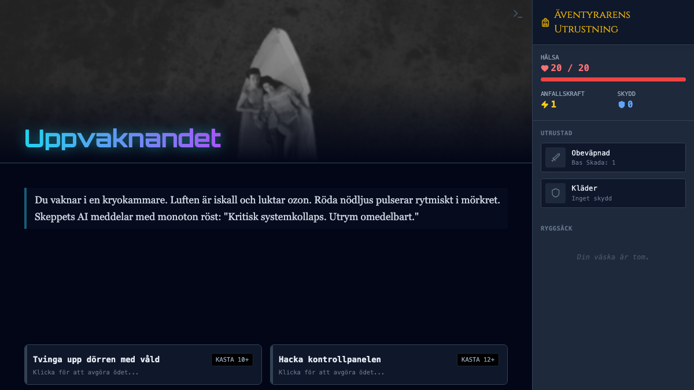

# Role Play Game

Ett textbaserat rollspel på svenska i rymdmiljö (*Starlight Odyssey*). Du vaknar på ett skepp i
kris, väljer vad du gör och slår en tjugosidig tärning när det behövs. En AI-berättare (Google
Gemini) skriver hur just ditt val gick.

**Spela:** https://starlight-odyssey-rpg-616316980220.us-west1.run.app · En del av [Skolappar](https://www.skolappar.com) – pedagogiska appar av föräldrar · öppen källkod (MIT)



Appen är byggd i Google AI Studio och körs på Google Cloud Run. Den är ännu inte flyttad till
Skolappars egen drift.

## Vad du kan göra

- **Förgrenad berättelse**: noder med text och vägval, definierade i `storyData.ts`, fram till
  ett slut där du kan starta om.
- **Tärningsslag (1–20)**: vissa val har en svårighet ("KASTA 12+"). Lyckas du går berättelsen
  åt ett håll, misslyckas du åt ett annat och tappar 2 HP.
- **AI-berättare**: efter ett tärningsslag skriver Gemini (`gemini-2.5-flash`) ett kort, dramatiskt
  stycke om utfallet. Går anropet fel visas den vanliga texten.
- **Inventarie och utrustning**: föremål som vapen, dräkt, nyckelkort och förbandslåda. Vapen
  och skydd kan utrustas och tas av, förbandslådan läker HP.
- **Adminläge** som visar alla noder, deras text och vägval (skrivskyddat – knapparna för att
  skapa och spara noder gör inget ännu).

## Kom igång

```bash
npm install
npm run dev      # utvecklingsserver
npm run build    # produktionsbygge till dist/
npm run preview  # förhandsgranska bygget
```

Appen behöver en Gemini-nyckel i miljövariabeln `API_KEY` (till exempel i `.env.local`).
`vite.config.ts` bakar in den i klientkoden vid bygget.

## Integritet

- Inget konto, inga kakor och ingen lagring i webbläsaren – spelet börjar om när sidan laddas om.
- **Google Gemini anropas direkt från webbläsaren** med nyckeln från `API_KEY`. Det som skickas
  är nodens text, ditt val och tärningsresultatet. Eftersom nyckeln ligger i den byggda koden
  kan den läsas av alla som öppnar appen.
- Scenbilderna hämtas från `picsum.photos`. Typsnitten (Cinzel, Orbitron, Roboto Mono) hämtas
  från Google Fonts och Tailwind från `cdn.tailwindcss.com`. `index.html` har också en
  importmap mot `esm.sh` från AI Studio. Adminvyns bakgrund hämtas från `transparenttextures.com`.
- Adminläget skyddas av en PIN-kod som står i klientkoden, så det är inget riktigt skydd.

## Struktur

```
App.tsx                    spelvy, tärningslogik, inloggning till adminläget
storyData.ts               berättelsens noder, val och föremål
services/geminiService.ts  anrop till Gemini
components/DiceRoller.tsx  tärningsanimation
components/Inventory.tsx   HP, utrustning och inventarie
components/AdminPanel.tsx  översikt över noderna
types.ts                   typer för noder, val, föremål och spelare
```

## Licens

MIT – se [LICENSE](LICENSE).
